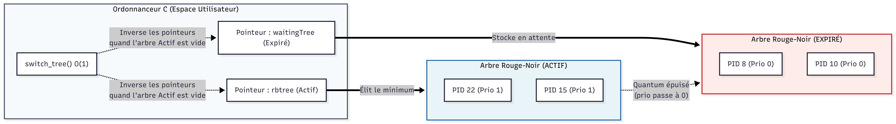

## Basic Schedulers: `scx_ksched` and `scx_mine`

Both `scx_ksched` and `scx_mine` follow a straightforward policy: they scan for the lowest eligible PID and schedule it next.

* **`scx_ksched`** (yes, I know, great creativity with the name) executes almost entirely inside the kernel using BPF programs.
* **`scx_mine`** delegates almost all scheduling decisions to userspace.

## Dynamic Queue Scheduler: `scx_dyna`

## Formula-Based Scheduler: `scx_kdyna`

`scx_kdyna` calculates task priority dynamically using the current scheduling cycle and the task's PID:

$$
\begin{aligned}
\text{priority} &= c \cdot b + \frac{\text{PID}}{1 + \alpha} \\
\alpha &= 0.001 \\
b &= \text{PID MAX} \cdot \alpha \\
c &= \text{cycle number}
\end{aligned}
$$
