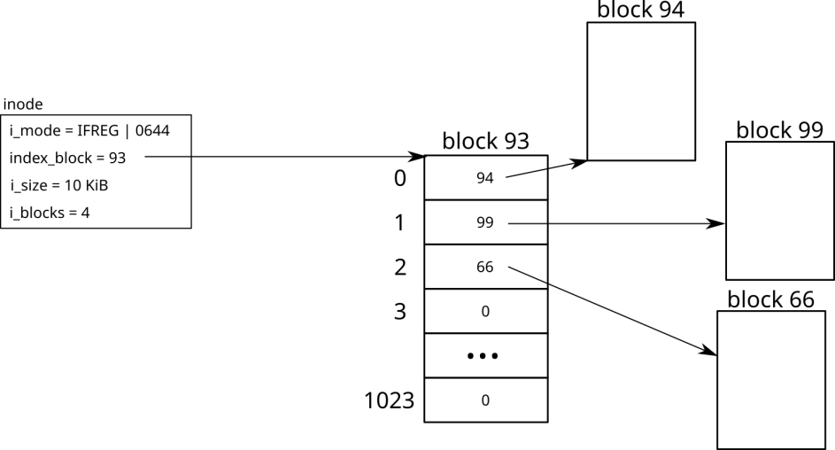
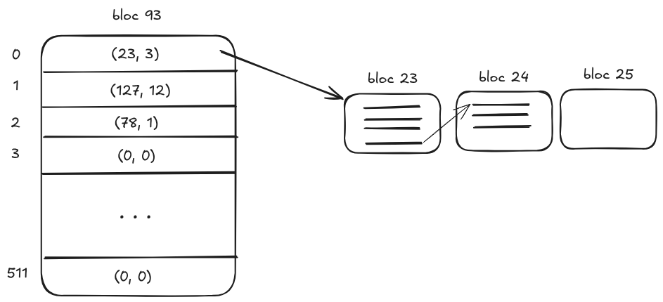

In the original `ouichefs` architecture, a file's data blocks are tracked as a flat list of individual block numbers stored inside a single fixed-size index block (see the [ouichefs README](./ouichefs/README.md) for full details):

**Wishfs** replaces this flat list with an **extent-based implementation**:

Instead of storing every individual block pointer, each entry in the index block is a struct containing:
1. **The starting block number** of a contiguous sequence.
2. **The number of contiguous blocks** that follow it.

When files are written contiguously, a single extent entry can represent a large span of data, allowing a single index block to address virtually unlimited file sizes.

